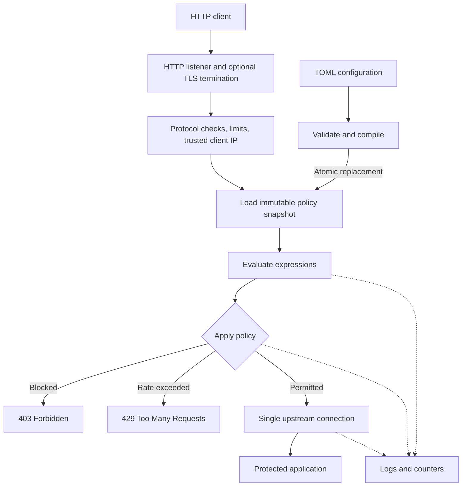

# SPIRL Architecture v0.1

**Project:** SPIRL (SPIRL Proxy Ingress Rate Limiter)  
**Status:** Accepted baseline for first beta; implementation details subject to validation  
**Decision date:** 2026-10-20  
**Target beta:** 2026-12-14

## 1. Purpose

SPIRL is a lightweight, self-hosted, rule-driven HTTP reverse proxy written in Rust. It runs on a single Linux server, accepts client connections, evaluates configurable request rules and rate limits, and forwards permitted traffic to one protected web application. It must work without AI, a database, Redis, or another required service.

SPIRL is an **application-layer** control, not a replacement for network-level DDoS mitigation. It cannot prevent bandwidth saturation upstream of the host. The protected origin must not be publicly reachable in a way that bypasses SPIRL.

## 2. Accepted architectural decisions

| Topic | Beta decision |
| --- | --- |
| Platform | Linux, x86-64 as the initial distribution target |
| Implementation | One Rust executable, modular internal code |
| HTTP proxy | Evaluate Pingora as the default foundation; validate its API in milestone 1 |
| Frontend TLS | HTTPS with user-provided certificate and private-key files |
| HTTP version | Guarantee HTTP/1.1 functionality; HTTP/2 is not a beta requirement |
| Origin | One configured upstream, with no load balancing |
| Origin transport | Plain HTTP on trusted local networks and verified HTTPS where configured |
| WebSockets | Not supported or promised for the beta |
| Policies | Local TOML file with a Cloudflare-inspired *subset* of expression syntax |
| Rate algorithm | Per-client token buckets, scoped by rule |
| State | Bounded, in-memory; no distributed state |
| Rule changes | Validate, then atomically replace the active policy snapshot on SIGHUP |
| Logs | Structured logs, with no request body or secret headers logged by default |
| AI | No AI feature or dependency in the beta |

The listener address, TLS settings, and upstream endpoint may require process restart; **only policy and rate-limit settings are guaranteed reloadable** in v0.1.

## 3. System and trust boundaries



The proxy is the boundary between untrusted public requests and the application. The administrator is responsible for restricting access to the origin, securing the private key, and assigning appropriate file and network permissions to the SPIRL process.

## 4. Internal modules and interfaces

A **single Cargo package** is sufficient initially. Modules are not independent processes and should not become separate crates without a specific reason.

```text
src/
  main.rs             startup, CLI, shutdown, signal handling
  proxy/              Pingora integration, listener, request and response forwarding
  identity/           authoritative client IP and trusted proxy configuration
  rules/              lexer, parser, AST, compiler, evaluator
  limiter/            token buckets, bounded concurrent storage, eviction
  config/             TOML schema, validation, immutable runtime snapshots
  observability/      logs, counters, timing

tests/                end-to-end proxy and policy tests
examples/config.toml  documented configuration example
```

**Dependency direction:** `proxy` invokes `identity`, `rules`, `limiter`, and `observability`; the latter modules do not depend on Pingora-specific request types. `config` exposes validated application-level data structures. This makes unit-testing and future replacement of the proxy foundation easier.

### Request context

Extract the minimal set of data required for policy evaluation once per request:

- Trusted client IP, derived from the TCP peer by default.
- HTTP method.
- Request path **without query string**.
- Selected headers, accessed by case-insensitive name.
- Immutable policy snapshot identifier.

The request path is initially matched as received, without percent-decoding or case normalization. This behavior must be documented and tested; path canonicalization is a future security-sensitive change. No request-body inspection is required.

## 5. HTTP request pipeline

1. Accept a connection; negotiate TLS if configured; apply connection and header limits.
2. Parse and validate the request; derive an authoritative client IP.
3. Capture one immutable policy snapshot for the request, preventing partial reloads.
4. Evaluate configured expressions in deterministic file order; collect matching `log`, `block`, and `rate_limit` actions.
5. `log` is non-terminal. If **any** block rule matches, return 403; do not contact the origin.
6. Otherwise evaluate **all** matching rate-limit rules. If any rejects the request, return 429 with `Retry-After` when computable; do not contact the origin.
7. Otherwise select the one configured upstream, sanitize hop-by-hop and forwarding headers appropriately, and stream the request and response.
8. Record outcome, status, latency, policy identifier, and safe counters.

There is **no beta `allow` action** that bypasses a later block or rate limit. If both a block and rate-limit rule match, block takes priority and buckets are not evaluated.

Multiple rate limits may match. Each independently assesses the request attempt against its bucket. These checks are **not transactional across different buckets**: earlier matched buckets can be charged even when a later bucket rejects the request. This is intentional and must be covered by tests and documentation.

## 6. Expression engine

Rules are compiled **once when configuration is validated**, not parsed for every request. Proposed initial syntax:

```text
http.request.uri.path eq "/login" and http.request.method eq "POST"
ip.src in {203.0.113.0/24 198.51.100.17}
http.request.headers["user-agent"] contains "ExampleBot"
```

Supported fields:

- `ip.src`: trusted client IP.
- `http.request.method`: HTTP method.
- `http.request.uri.path`: path without the query string.
- `http.request.headers["name"]`: first matching header value for the named header; header names are case-insensitive.

Supported operations: `eq`, `ne`, `contains`, `in` (CIDR or IP membership on `ip.src` only), `and`, `or`, `not`, and parentheses. Set literals are whitespace-delimited. No regex, arbitrary functions, request-body inspection, JavaScript, or dynamic code execution in the beta.

Invalid syntax, unsupported fields, inappropriate operand types, excess expression length, or excessive nesting must cause validation to fail. Do not silently ignore invalid security rules.

## 7. Rate limiter

Use a token bucket for each `(stable_rule_id, client_ip)` key. `requests = N`, `period = T`, and `burst = B` specify a refill rate of `N / T` tokens per second and a capacity of `B` tokens. A permitted attempt consumes one token. The full initial bucket permits a burst of `B` requests; this is **not** a strict sliding-window count.

Design requirements:

- Use a monotonic timer for refill calculations.
- Make bucket updates concurrency-safe, with striped or sharded locking rather than one global mutex on the hot path.
- Bound entries and evict idle state; configure capacity and expiration.
- When capacity is exhausted, refuse previously unseen rate-limit keys with 429 rather than silently bypassing enforcement; emit a distinct metric and warning.
- Preserve state for unchanged rule identities and parameters on reload, and retire obsolete buckets safely.
- A process restart resets in-memory rate-limit state. Document this limitation.

A global connection and request concurrency guard should also protect the proxy independently of keyed rate limits.

## 8. TLS, client identity, and upstream security

- **Downstream HTTPS:** load certificate and private key from restricted local files. Support contemporary TLS defaults; disable legacy protocol versions. Automatic certificate issuance is out of scope.
- **Upstream:** support exactly one endpoint. Permit HTTP for a localhost or otherwise trusted deployment; use HTTPS with certificate and hostname validation when the origin connection crosses an untrusted network. Never disable validation silently.
- **Client identity:** use the direct TCP peer by default. Interpret `X-Forwarded-For` or similar forwarded-IP headers only when the immediate connecting peer is explicitly trusted. Spoofed forwarded headers must never change the rate-limit key.
- **HTTP header security:** use the proxy framework's safe defaults for hop-by-hop headers and reject ambiguous forwarding metadata; validate behavior in integration tests.
- **Origin exposure:** bind the application to loopback where possible or use firewall rules to prevent direct internet access.

## 9. Configuration and reloading

- TOML file with an explicit schema version and clear error messages.
- Startup: parse, validate, compile policies, initialize state, **then** begin serving.
- `spirl check --config <path>` validates configuration without starting the listener.
- On SIGHUP: build a new, complete policy snapshot; publish it atomically if valid; retain the last known-good snapshot if invalid.
- Requests already in progress finish against the policy snapshot they began with.
- Listener and TLS configuration changes are applied by a controlled restart in v0.1.
- A rule's stable ID must not change during routine edits that preserve its rate-limit meaning.

Example **design sketch** (not yet implemented):

```toml
schema_version = 1

[server]
listen_http = "127.0.0.1:8080"
listen_https = "0.0.0.0:443"

[tls]
certificate_file = "/etc/spirl/tls/fullchain.pem"
private_key_file = "/etc/spirl/tls/privkey.pem"

[upstream]
url = "http://127.0.0.1:9000"

[limiter]
max_entries = 100000
idle_ttl = "10m"

[[rules]]
id = "protect-login"
expression = 'http.request.uri.path eq "/login" and http.request.method eq "POST"'
action = "rate_limit"
requests = 10
period = "60s"
burst = 10
key = "ip.src"

[[rules]]
id = "block-example-network"
expression = 'ip.src in {203.0.113.0/24}'
action = "block"
```

The exact keys and defaults must be frozen alongside the first versioned configuration parser.

## 10. Observability and errors

Log startup, shutdown, rejected requests, config reload outcomes, and upstream errors. Counters should distinguish forwarded, blocked, rate-limited, upstream failures, rule-evaluation failures, and limiter state-capacity events. Avoid logging request bodies, authentication tokens, cookies, or full query strings by default.

Expected responses include: `403` for explicit block, `429` for rate exhaustion, `502` for upstream connection or protocol errors, and `504` for upstream timeouts. Use bounded timeouts and return generic messages rather than internal error details.

## 11. Verification and non-goals

Verify proxy fidelity, TLS, rule precedence, per-IP independence, burst behavior, concurrent requests, state eviction, invalid reload rollback, client-IP spoofing protection, and safe upstream failure. Benchmark latency, throughput, CPU, and idle and loaded RSS against an unprotected baseline; **do not invent performance claims before measurement**.

Not in v0.1: WebSockets, multiple origins and load balancing, HTTP/3, distributed counters, bot scoring, AI, JavaScript or regex rule evaluation, dashboard, automatic ACME, challenge pages, network-layer DDoS protection, or Cloudflare language compatibility guarantees.

## 12. References

- [Pingora quick start](https://github.com/cloudflare/pingora/blob/main/docs/quick_start.md)
- [Pingora request lifecycle and filters](https://github.com/cloudflare/pingora/blob/main/docs/user_guide/phase.md)
- [Pingora upstream peer options](https://github.com/cloudflare/pingora/blob/main/docs/user_guide/peer.md)
- [Cloudflare rules expression concepts](https://developers.cloudflare.com/ruleset-engine/rules-language/expressions/)

These references inform the design; SPIRL's behavior is defined by this document and its tests, not by future changes to upstream documentation.
